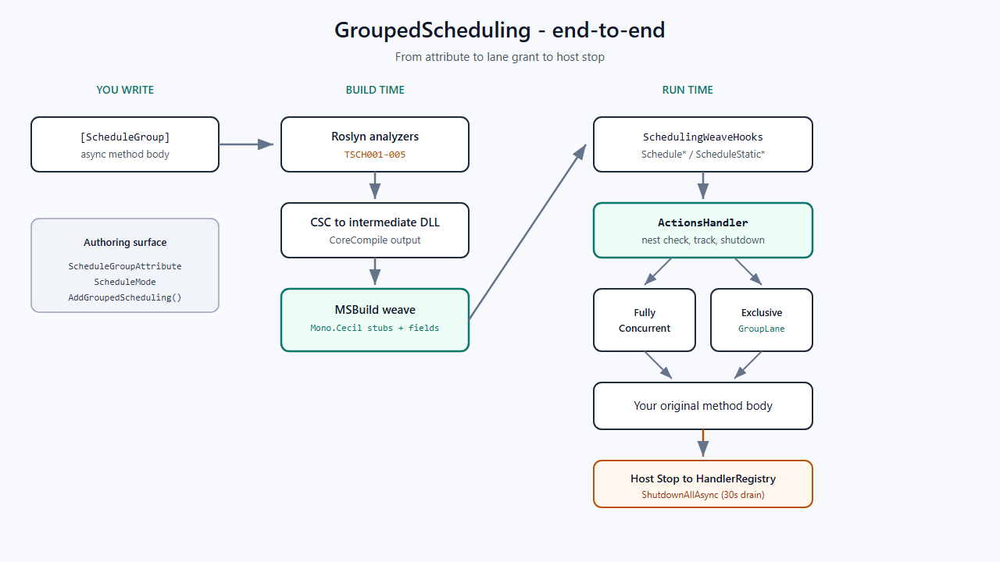
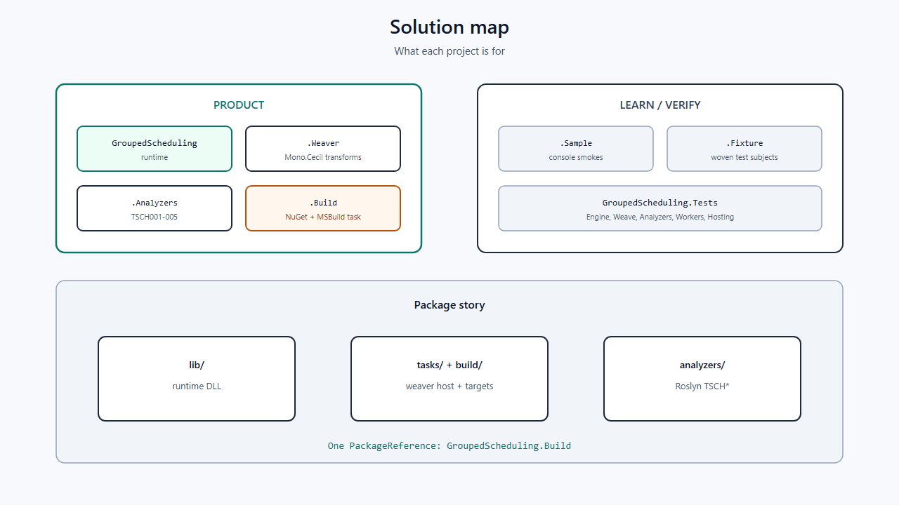

# Mental model: one story for the whole system

Before any file, hold this picture in your head. Every later chapter is a zoom into one box.

## The one-sentence product

You write normal `async` methods, mark them with `[ScheduleGroup(name, mode)]`, and callers keep writing `await service.SaveAsync(...)`. At **build time**, an MSBuild weaver rewrites those methods so every entry path (direct call, delegate, reflection) goes through a scheduler that enforces group concurrency and nesting rules. At **process stop**, a hosted service drains all tracked handlers.

## Picture first





## ASCII map (end to end)

```text
  YOU WRITE                     BUILD TIME                      RUN TIME
  ---------                     ----------                      --------
  [ScheduleGroup(...)]   -->   Roslyn analyzers (TSCH*)   -->  (IDE squiggles)
           |                         |
           v                         v
      C# method body   -->   CSC -> DLL  -->  Mono.Cecil weave
           |                                      |
           |                                      v
           |                              wrapper + fields + dispose
           |                                      |
           +------------------------------------->|
                                                  v
                                    SchedulingWeaveHooks.Schedule*
                                                  |
                                                  v
                                           ActionsHandler
                                          /              \
                           FullyConcurrent            Exclusive*
                                  |                        |
                                  v                        v
                           RunWithNestAsync        GroupLaneScheduler
                                                                  |
                                                                  v
                                                           your original body
```

## Three layers of “truth”

| Layer | Question it answers |
|---|---|
| **Attribute + modes** | *Which named queue am I on, and what concurrency policy?* |
| **ActionsHandler + lane** | *May I run now? Who waits? What cancels waiters?* |
| **Nest + owner CTS + registry** | *Am I illegally re-entering? Who cancels on dispose/host stop?* |

If you confuse these layers, the code looks “random.” If you keep them separate, almost every method has an obvious home.

## Groups are not global

A group name like `"orders"` is **not** a process-wide lock.

- Instance attributed methods → one `ActionsHandler` **per object**.
- Static attributed methods → one `ActionsHandler` **per declaring type**.
- Same name on two different classes → **two independent queues**.

**Why it matters:** you can have many `OrdersService` instances; each serializes its own `"orders"` work, not everyone else’s.

## Modes in one breath

| Mode | Exclusive lane? | Inside the active group |
|---|---|---|
| `ExclusiveSerial` | Yes — one exclusive group active | One task at a time |
| `ExclusiveParallel` | Yes — one exclusive group active | Many tasks may overlap |
| `FullyConcurrent` | **No** — bypasses the lane | Runs immediately |

Exclusive modes share **one lane** on that handler: group A and group B never both hold the lane. Waiting groups activate **FIFO**.

## Nest rule (the sharp edge)

While work from handler `H` is running, you must not call another scheduled method that also uses `H`. Cross-handler calls (`A → B`) are fine. Same-handler re-entry throws.

**Concept:** nesting is tracked with `AsyncLocal` so it follows `await` across threads.

## Shutdown is layered cancellation

```text
  Host StopAsync
       |
       v
  HandlerRegistry.ShutdownAllAsync
       |
       +--> each InstanceSchedulingState / StaticSchedulingState
                 |
                 +--> cancel owner CTS
                 +--> ActionsHandler.ShutdownAsync (cancel waiters, drain in-flight)
```

Per-call tokens are **linked** with the owner token so dispose/host stop can cancel in-flight work that honors `CancellationToken`.

## Why weave instead of proxies?

Attributed methods must stay scheduled when taken as a **method group** or invoked via **delegate** / **reflection**. Wrapping the **method body** (not the call site) guarantees every entry path. That design choice drives the whole Weaver project.

## Tiny “before / after” intuition

You write:

```csharp
[ScheduleGroup("orders", ScheduleMode.ExclusiveSerial)]
public async Task SaveAsync(Order o, CancellationToken ct) { ... }
```

After weave (conceptually — not literal C#):

```csharp
public Task SaveAsync(Order o, CancellationToken ct)
{
    var state = EnsureInstanceState();
    return SchedulingWeaveHooks.Schedule(state, groupId: ORDERS, work: __impl, ct);

    async Task __impl(CancellationToken linked)
    {
        // your original body, using linked token
    }
}
```

The public signature stays callable the same way. The scheduling is inside.

## Checkpoint

If you can answer these without looking, you are ready for Part II:

1. Where does exclusive serialization live — attribute, handler, or lane?
2. Does `"orders"` on two classes share a queue?
3. Why does weaving beat call-site interception for delegates?

Answers: (1) lane via handler for exclusive modes; (2) no; (3) body wrap hits every entry path.
