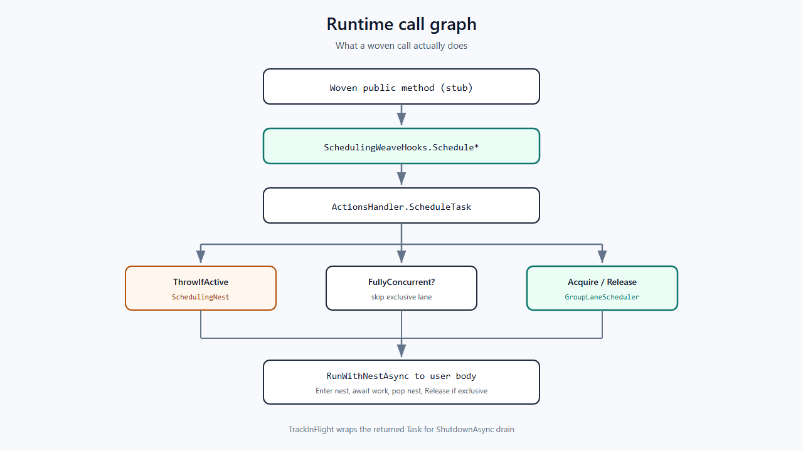
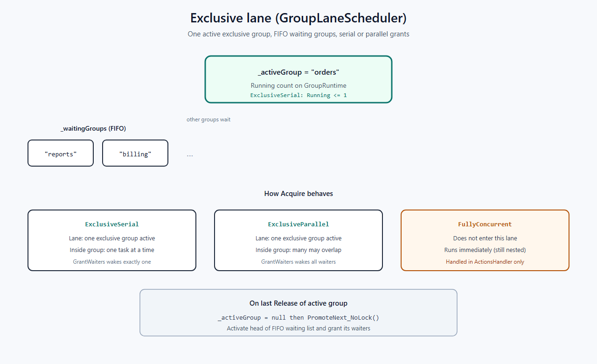
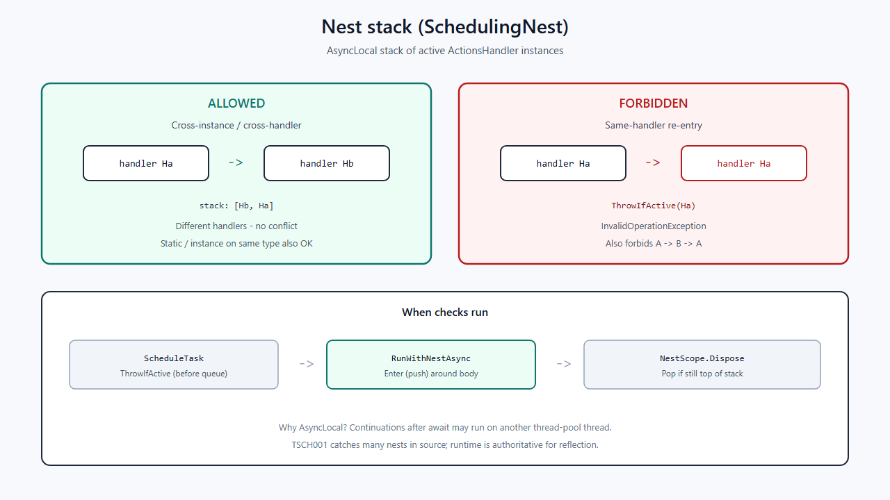
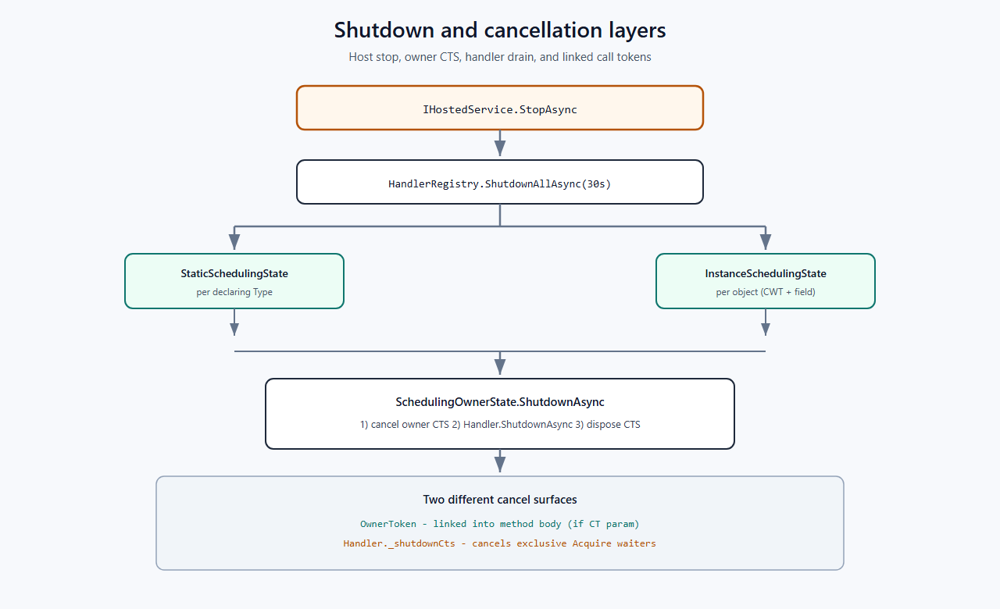
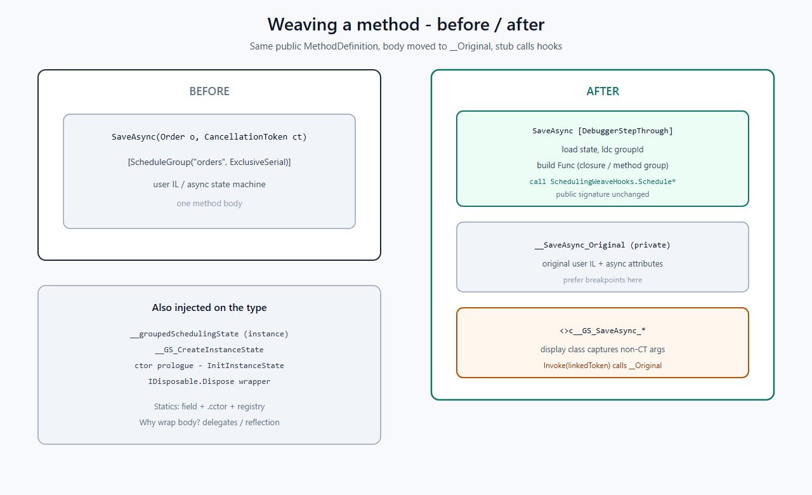

# Figures (diagram gallery)

All diagrams live under `docs/tutorial/assets/` as editable `.svg` sources and rendered `.png` files (Google Docs / DOCX friendly).

Re-render after editing an SVG:

```powershell
powershell -NoProfile -ExecutionPolicy Bypass -File docs/tutorial/scripts/render-diagrams.ps1
```

## Solution map


## End-to-end pipeline


## Runtime call graph



## Exclusive lane



## Nest stack



## Shutdown layers



## Weave before / after


